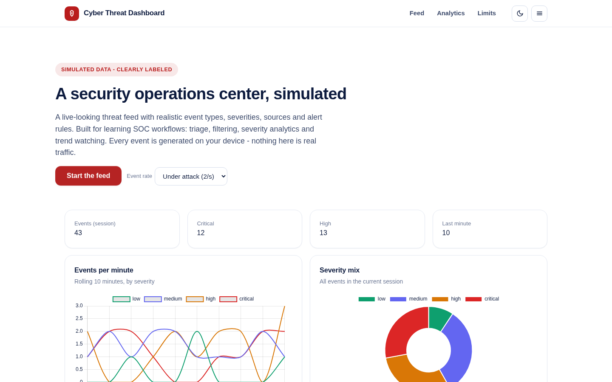
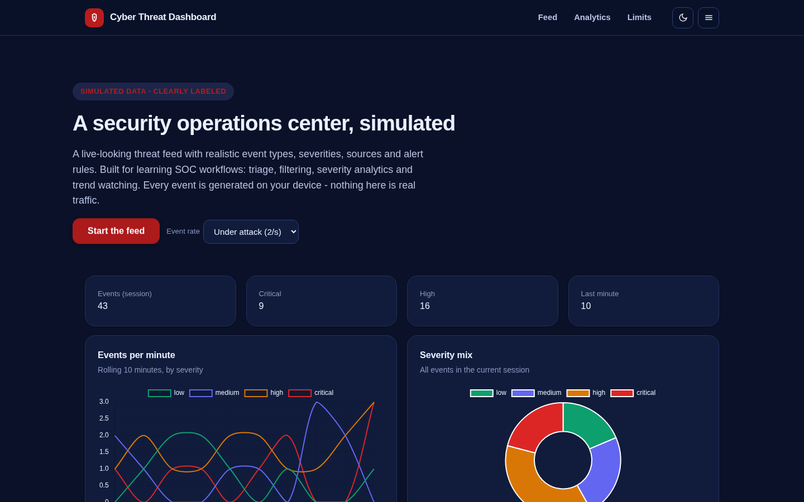
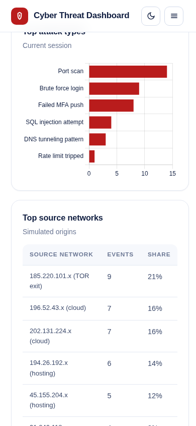

# Cyber Threat Dashboard

A security operations center, simulated honestly on your device.

A live-looking threat feed with realistic event types (brute force, SQLi, phishing, malware signatures, DNS tunneling), severities, source networks and targets - built for learning SOC workflows: triage, filtering, severity analytics and trend watching. Every event is generated locally and the app says so.

**Live demo:** https://akash991833.github.io/cyber-threat-dashboard/



## Features

- Live event feed at three paces (calm, busy, under attack), pauseable
- Rolling 10-minute events-per-minute chart by severity, severity doughnut, top attack types bar chart
- Top source networks table with event share
- Severity and text filtering on the feed, JSON export
- Seeded history so the dashboard is alive on first load
- Dark and light themes, responsive, installable PWA, works offline

## Honest limits

- Every event is simulated in your browser. This is a training and demo tool for SOC workflows, not connected to any real network, honeypot or threat intel feed.
- Patterns are scripted randomness, not detected attacks.

## Tech

Vanilla JS + Chart.js (vendored), no build step. Weighted-random event generator with realistic attack-type distribution.

## Run locally

```
python3 -m http.server 8070
# open http://localhost:8070
```

## Tests

```
python3 -m http.server 8070 &
node tests/run.mjs
```

48 checks across desktop and mobile, light and dark: seeded history, severity variety, live feed growth and pause, severity and text filters, sources table, chart rendering, simulation disclaimer and console cleanliness.



